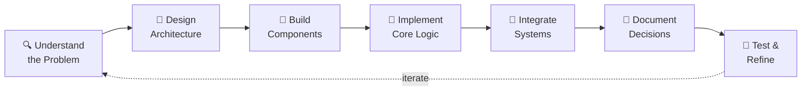

<!-- ========================= HEADER ========================= -->

 

  

 

<!-- ========================= ABOUT ========================= -->
## 👋 About Me

> Mahasiswa Informatika **Universitas Diponegoro** yang suka membangun software praktis, mudah dirawat, dan menyelesaikan masalah nyata.

Minat saya mencakup **full-stack development**, **system architecture**, **financial technology**, **IoT**, dan **parallel computing**. Saya senang mengerjakan proyek yang memadukan pengalaman pengguna yang bersih, logika backend yang andal, dan desain yang dipikirkan matang.

<table>
  <tr>
    <td align="center">🎓 <b>Learn</b> Software engineering principles & best practices</td>
    <td align="center">💻 <b>Build</b> End-to-end solutions from database to UI</td>
    <td align="center">🧠 <b>Design</b> System architecture & scalability</td>
    <td align="center">🤝 <b>Collaborate</b> Meaningful projects with great people</td>
    <td align="center">🚀 <b>Ship</b> Turning ideas into working applications</td>
  </tr>
</table>

 

<!-- ========================= WHAT I BUILD ========================= -->
## 🛠️ What I Build

| | Area | What I Do |
|:-:|---|---|
| 🧱 | **Software Engineering** | Clean code, modular architecture, meaningful documentation, testing |
| 🌐 | **Web Applications** | Responsive frontends, REST APIs, user authentication, CRUD systems |
| 💰 | **Financial Systems** | Portfolio management, investment optimization, financial goal tracking |
| 📡 | **IoT Applications** | MQTT-based real-time monitoring, sensor dashboards, automation |
| ⚙️ | **Backend Systems** | Layered architecture, business logic, database integration, validation |
| ⚡ | **Parallel Computing** | MPI-based distributed processing, data analysis at scale |

 

<!-- ========================= TECH STACK ========================= -->
## 🛠️ Mastered Tech Stack

### Languages

|  |  |  |  |  |  |  |  |
|:---:|:---:|:---:|:---:|:---:|:---:|:---:|:---:|
| **Java** | **Python** | **PHP** | **JavaScript** | **TypeScript** | **C** | **HTML** | **CSS** |
| Backend services & enterprise apps | Algorithms, data analysis, desktop apps | Web application development | Interactive web development | Type-safe frontend development | System & parallel programming | Structured web markup | Styling & responsive design |

### Frontend

|  |  |  |
|:---:|:---:|:---:|
| **React** | **Vite** | **Tailwind CSS** |
| Component-based UI development | Fast modern build tooling | Utility-first responsive styling |

### Backend & Database

|  |  |  |
|:---:|:---:|:---:|
| **Spring Boot** | **Laravel** | **MySQL** |
| REST API & backend services | PHP framework for web apps | Relational database design |

### Systems & Tools

|  |  |  |  |
|:---:|:---:|:---:|:---:|
| **Git** | **GitHub** | **VS Code** | **Maven** |
| Version control & collaboration | Code hosting & project management | Primary development environment | Java build & dependency management |

 

<!-- ========================= FEATURED PROJECTS ========================= -->
## 🚀 Featured Projects

<table>
  <tr>
    <td width="50%" valign="top">
      
      <code>React</code> <code>TypeScript</code> <code>Spring Boot</code> <code>MySQL</code> <code>JWT</code> <code>Vite</code>
    </td>
    <td width="50%" valign="top">
      
      <code>Laravel</code> <code>PHP</code> <code>MySQL</code> <code>Blade</code> <code>Tailwind CSS</code>
    </td>
  </tr>
  <tr>
    <td width="50%" valign="top">
      
      <code>React</code> <code>TypeScript</code> <code>Spring Boot</code> <code>MySQL</code> <code>JWT</code>
    </td>
    <td width="50%" valign="top">
      
      <code>React</code> <code>Vite</code> <code>Tailwind CSS</code> <code>MQTT</code> <code>IoT</code>
    </td>
  </tr>
</table>

<b>🛒 E-Commerce Platform</b> — single-vendor store, from product discovery to payment

 

- User registration & JWT-based authentication
- Product catalog with search and filtering
- Shopping cart with real-time updates
- Checkout flow with order tracking & history
- Mock payment gateway integration
- Flash sale system with countdown timers
- Toast notifications for user feedback

🔗 [Repository](https://github.com/adityaulyaa/E-COMMERCE) · [Project Guide](https://github.com/adityaulyaa/E-COMMERCE/blob/main/docs/gambaran_project.md)

<b>🏫 Campus Facility Reservation System</b> — multi-role facility management for universities

 

- Multi-role authorization (Users, Staff, Administrators)
- Availability calendar with 30-minute time slots
- Reservation approval workflow with conflict prevention
- Facility damage reporting with photo uploads
- Administrative dashboard & user verification
- Advanced reporting (CSV, Excel, PDF exports)
- Real-time availability status

🔗 [Repository](https://github.com/adityaulyaa/ProjectReservasiRuangan) · [Setup Guide](https://github.com/adityaulyaa/ProjectReservasiRuangan/blob/main/README.md)

<b>💎 Wealth Management System</b> — personal finances, portfolios, and goals

 

- Complete 3-tier architecture (React → Spring Boot → MySQL)
- JWT authentication with BCrypt
- Portfolio CRUD with allocation management
- Financial goal tracking with automatic progress calculation
- Custom React hooks for state management
- REST API design with comprehensive documentation
- Database schema (ERD) and sequence diagrams

🔗 [Repository](https://github.com/adityaulyaa/WealthManagementSystem) · [Documentation](https://github.com/adityaulyaa/WealthManagementSystem/tree/main/docs)

<b>🌡️ EcoTherma Smart Building Dashboard</b> — real-time IoT monitoring via MQTT

 

- MQTT real-time data streaming
- Live temperature monitoring with threshold alerts
- PIR-based occupancy detection
- Automatic AC control and mode optimization
- Energy efficiency scoring & dynamic AI recommendations
- Responsive design and visual energy usage monitoring

🔗 [Repository](https://github.com/adityaulyaa/eco-therma-ai)

 

## 📚 Other Technical Projects

<table>
  <tr>
    <td width="50%" valign="top">
      
      Branch & Bound · Dynamic Programming · Genetic Algorithm · Tkinter GUI
    </td>
    <td width="50%" valign="top">
      
      <code>MPI_Scatterv</code> · <code>MPI_Bcast</code> · <code>MPI_Reduce</code> · anomaly detection in C
    </td>
  </tr>
</table>

 

<!-- ========================= APPROACH ========================= -->
## 🧠 How I Approach Projects

<table>
  <tr>
    <td>✨ Clear separation of concerns</td>
    <td>🔄 Reusable, maintainable code</td>
    <td>🎯 Pragmatic system design</td>
    <td>📖 Meaningful documentation</td>
    <td>🚀 Continuous learning</td>
  </tr>
</table>

 

<!-- ========================= EXPLORING ========================= -->
## 🌱 Currently Exploring

 

<!-- ========================= STATS ========================= -->
## 📊 GitHub Activity

 

<!-- ========================= SNAKE ========================= -->

<picture>
  <source media="(prefers-color-scheme: dark)" srcset="https://raw.githubusercontent.com/adityaulyaa/adityaulyaa/output/github-snake-dark.svg" />
  <source media="(prefers-color-scheme: light)" srcset="https://raw.githubusercontent.com/adityaulyaa/adityaulyaa/output/github-snake.svg" />
  
</picture>

 

<!-- ========================= CONNECT ========================= -->
## 💬 Let's Connect

Selalu terbuka untuk kolaborasi proyek menarik, diskusi software engineering, dan eksplorasi teknologi baru.

  

